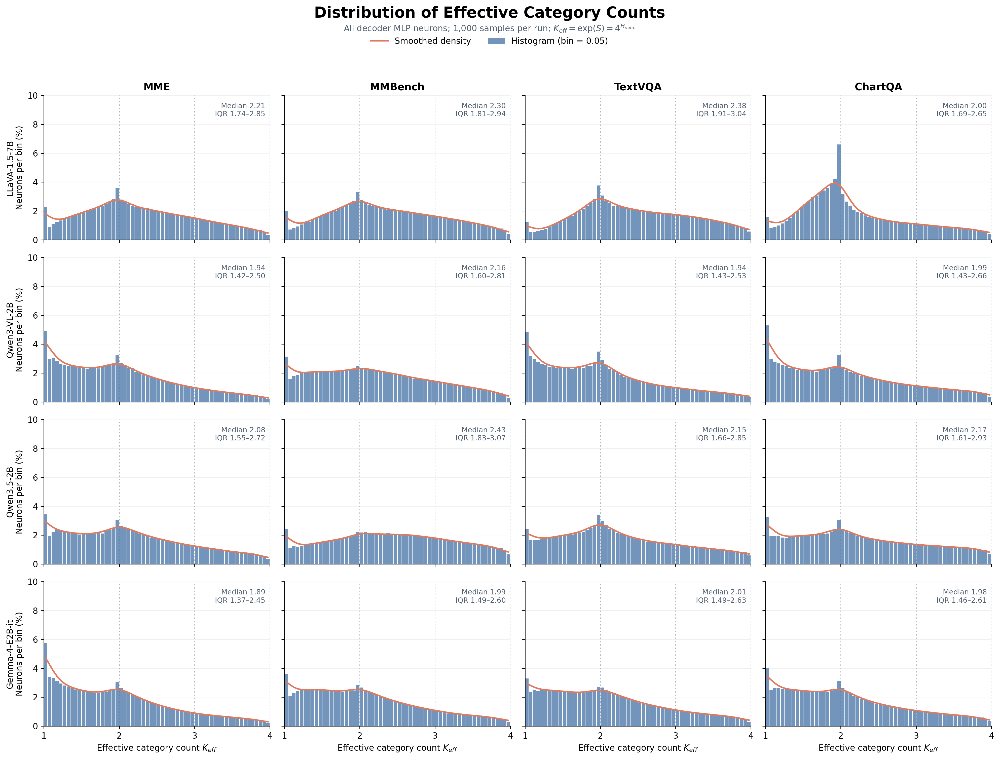
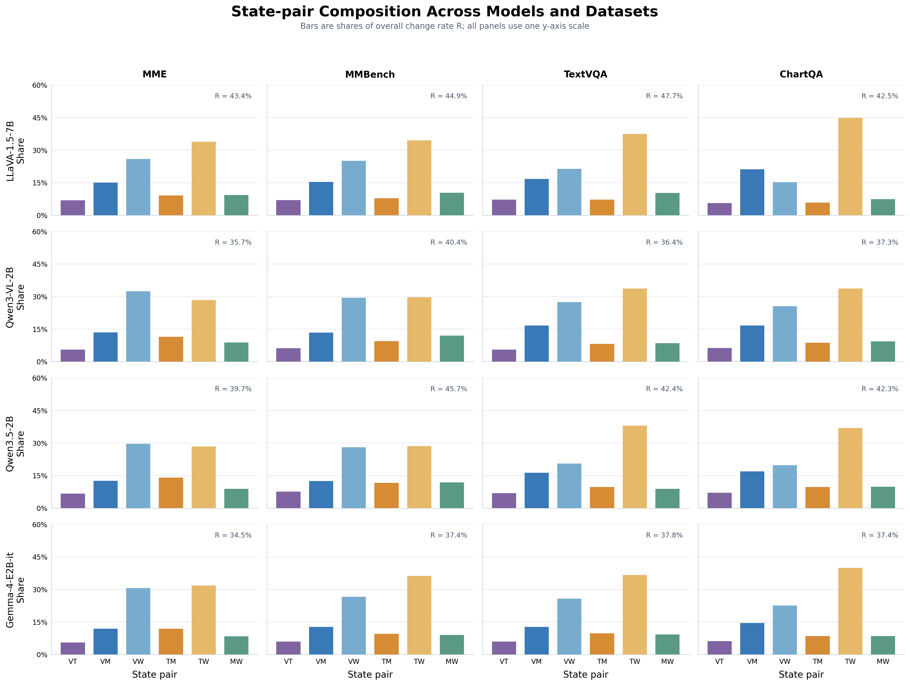
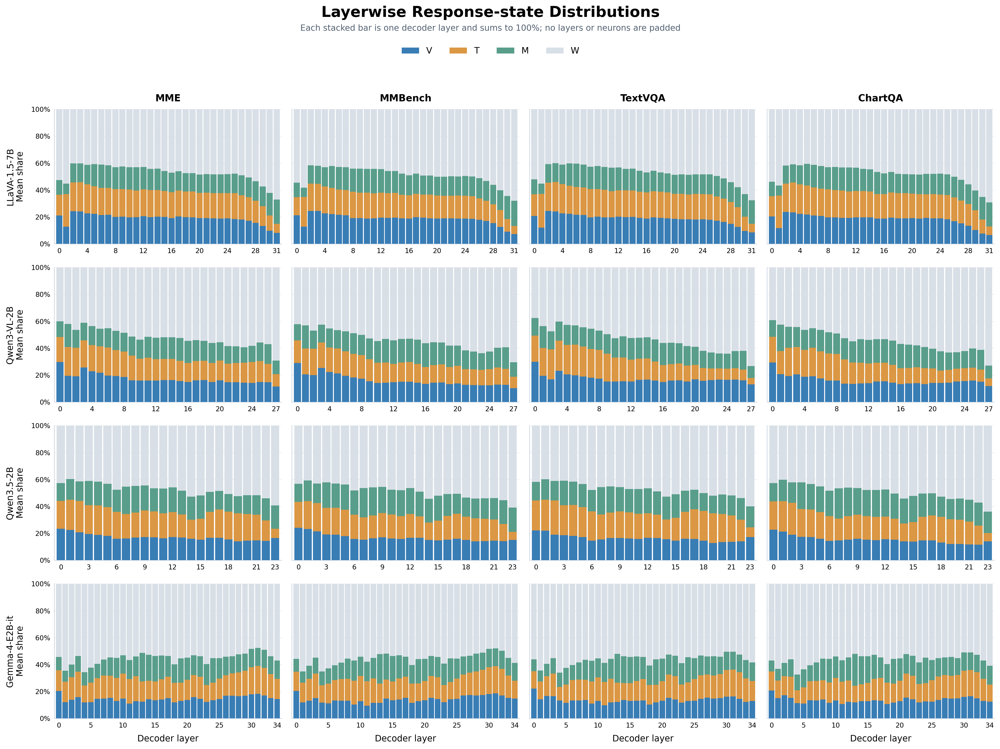

# MMBench 输入修正后的四组实验结果

## 输入口径

MMBench 的 1,000 个冻结样本保持不变。四个模型均重新以前向输入“图像 + 问题 + 有效选项”计算
`q^V`、`q^T` 和 `V/T/M/W` 状态；空选项与 `nan` 选项被过滤，dataset `hint` 和答案输出格式约束均不
进入状态计算。MME、TextVQA 与 ChartQA 沿用原冻结结果。

## Q1：总体变化率

| Model / Dataset | MME | MMBench | TextVQA | ChartQA |
|---|---:|---:|---:|---:|
| LLaVA-1.5-7B | 0.433521 | 0.449266 | 0.477110 | 0.425338 |
| Qwen3-VL-2B | 0.356979 | 0.403855 | 0.363509 | 0.373076 |
| Qwen3.5-2B | 0.396800 | 0.456560 | 0.424358 | 0.422823 |
| Gemma-4-E2B-it | 0.344638 | 0.374428 | 0.377963 | 0.373742 |

修正后的 MMBench 变化率仍然较高，但不再是四个模型都严格最高：LLaVA 的 TextVQA 更高；Gemma 的
TextVQA 也略高于 MMBench；Qwen3-VL 和 Qwen3.5 仍在 MMBench 上最高。与旧“问题-only”结果相比，
MMBench 的变化率分别下降 0.031638、0.006817、0.028094 和 0.018232。

## Q2：有效类别数

归一化熵为 `H_norm=S/log(4)` 时，使用 `K_eff=exp(S)=4^H_norm`。

| Model / Dataset | MME | MMBench | TextVQA | ChartQA |
|---|---:|---:|---:|---:|
| LLaVA-1.5-7B | 2.210 | 2.297 | 2.382 | 1.999 |
| Qwen3-VL-2B | 1.939 | 2.156 | 1.942 | 1.987 |
| Qwen3.5-2B | 2.080 | 2.429 | 2.147 | 2.166 |
| Gemma-4-E2B-it | 1.888 | 1.994 | 2.012 | 1.978 |

## Q3：状态对组成

| Model | R | VT | VM | VW | TM | TW | MW | 最大状态对 |
|---|---:|---:|---:|---:|---:|---:|---:|---|
| LLaVA-1.5-7B | 0.449266 | 7.0% | 15.3% | 25.0% | 7.8% | 34.5% | 10.3% | TW |
| Qwen3-VL-2B | 0.403855 | 6.1% | 13.3% | 29.5% | 9.5% | 29.6% | 12.0% | TW |
| Qwen3.5-2B | 0.456560 | 7.6% | 12.4% | 28.0% | 11.6% | 28.5% | 11.8% | TW |
| Gemma-4-E2B-it | 0.374428 | 6.0% | 12.8% | 26.6% | 9.5% | 36.2% | 9.0% | TW |

四个修正后的 MMBench 运行均以 `TW` 为最大组成，但 Qwen3-VL 和 Qwen3.5 的 `TW` 与 `VW` 非常接近。
四个运行中涉及 `W` 的状态对 `VW+TW+MW` 分别占 69.8%、71.1%、68.3% 和 71.8%，因此“多数差异
涉及 W”这一总体结论仍成立。六项贡献之和与总体 `R` 的最大数值残差为 `2.220e-16`。

## Q4：逐层状态分布

| Model | Layers | Neurons | V | T | M | W |
|---|---:|---:|---:|---:|---:|---:|
| LLaVA-1.5-7B | 32 | 352,256 | 18.5% | 17.1% | 15.2% | 49.3% |
| Qwen3-VL-2B | 28 | 172,032 | 16.1% | 14.7% | 15.1% | 54.0% |
| Qwen3.5-2B | 24 | 147,456 | 16.7% | 17.0% | 17.4% | 48.9% |
| Gemma-4-E2B-it | 35 | 337,920 | 14.5% | 16.0% | 14.4% | 55.1% |

修正后 MMBench 的四类平均分布仍与同一模型在其他数据集上的分布接近，支持“整体类别占比主要具有
模型特征”的描述性判断；但数据集输入仍会造成可测差异，因此不应表述为完全与数据集无关。所有层的
四类占比和均为 100%，最大残差为 `1.110e-16`。

