# W/C ablation: 16 individual figures

## LLaVA-1.5-7B

### MME

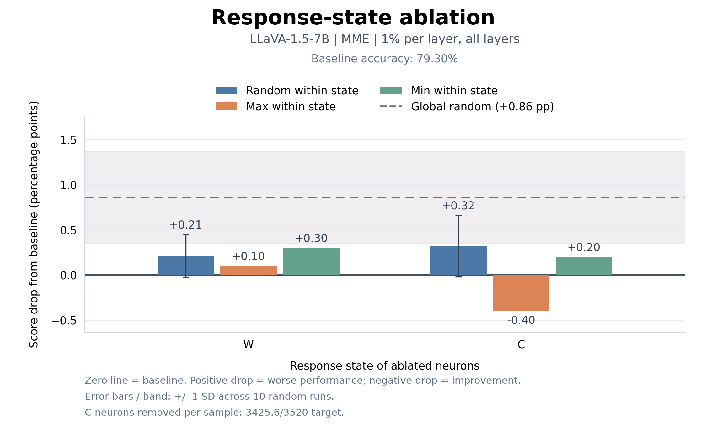

### MMBench

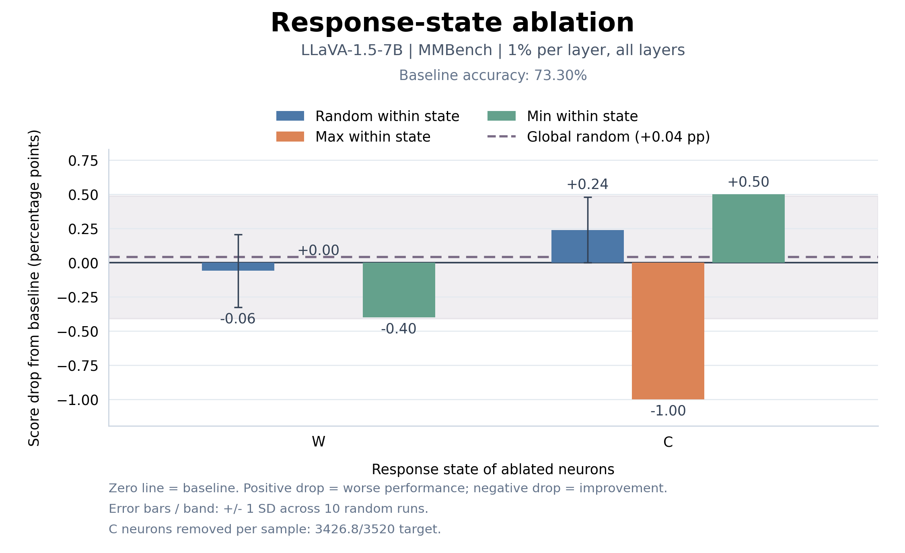

### TextVQA

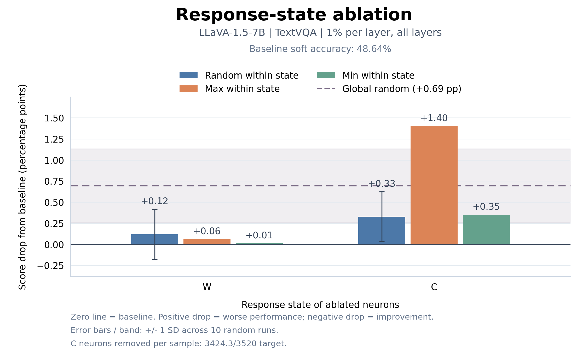

### ChartQA

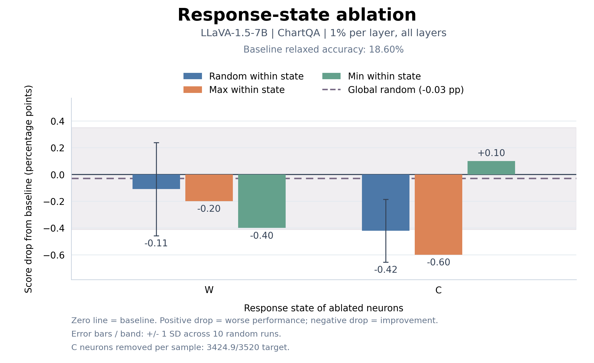

## Qwen3-VL-2B

### MME

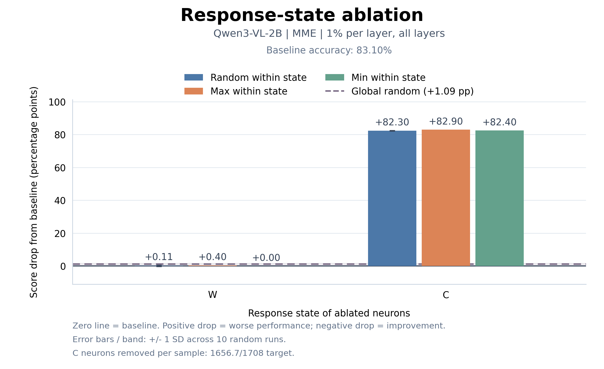

### MMBench

### TextVQA

### ChartQA

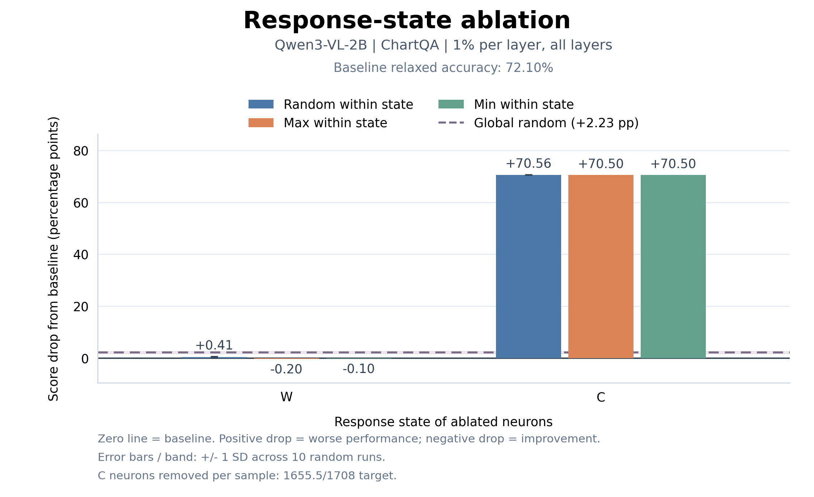

## Qwen3.5-2B

### MME

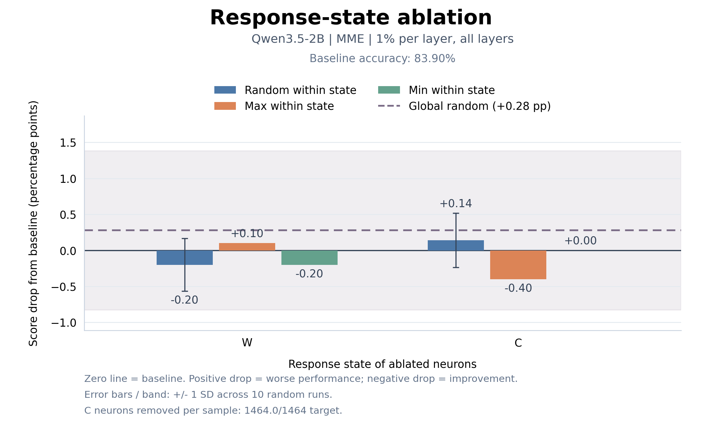

### MMBench

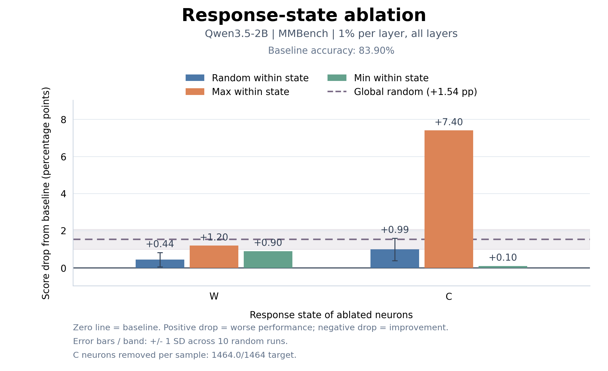

### TextVQA

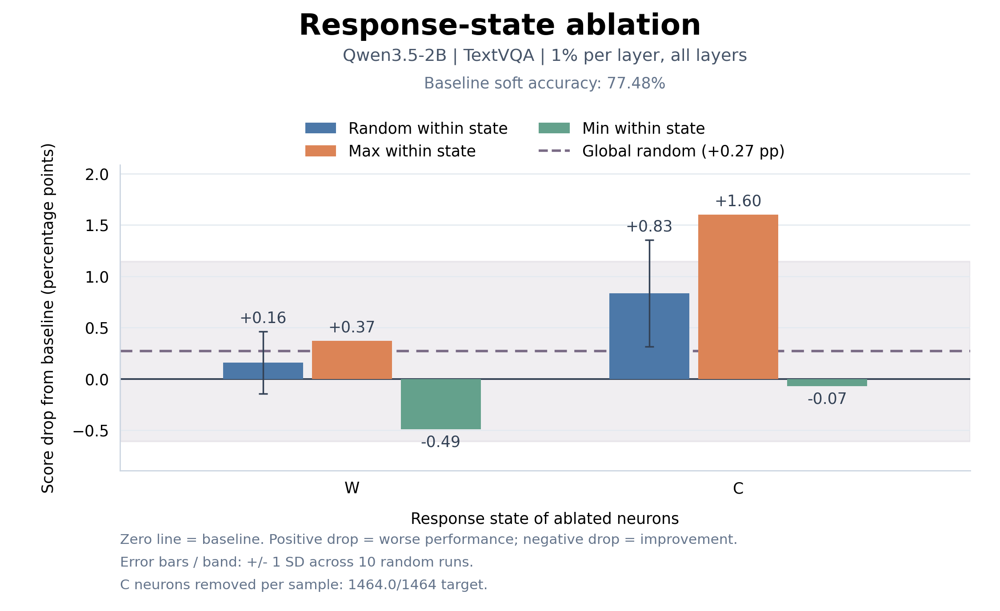

### ChartQA

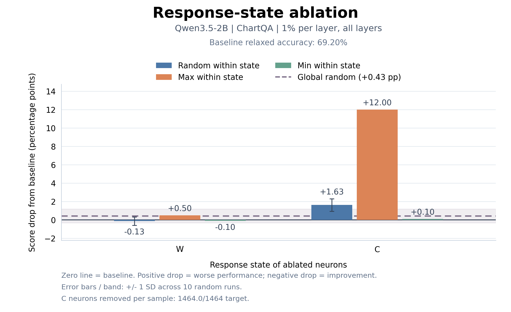

## Gemma-4-E2B-it

### MME

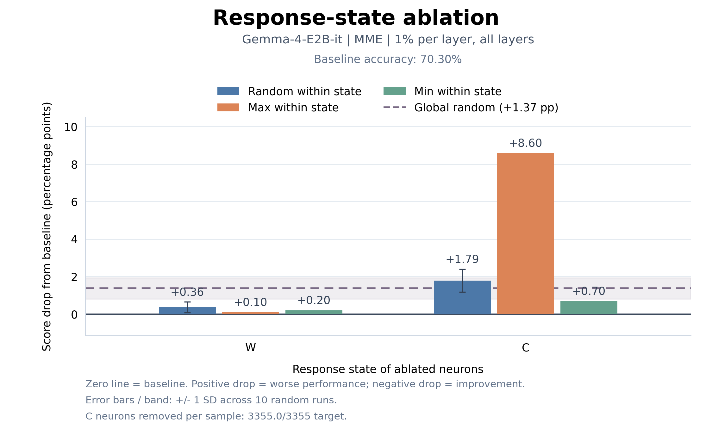

### MMBench

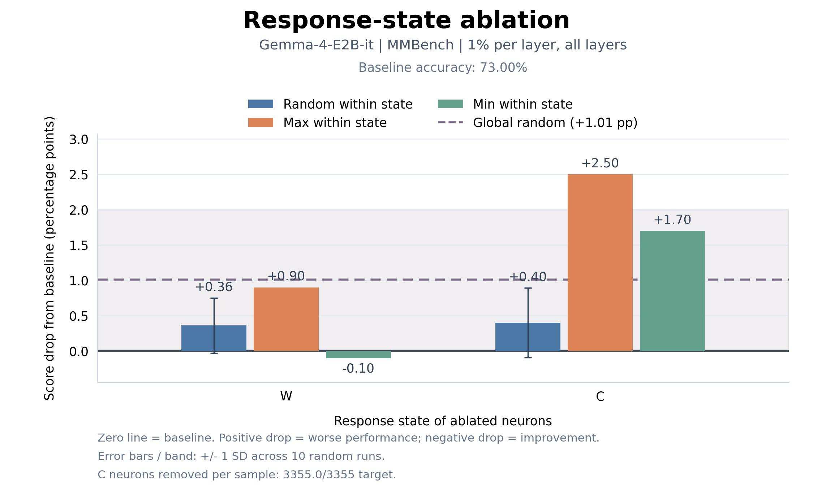

### TextVQA

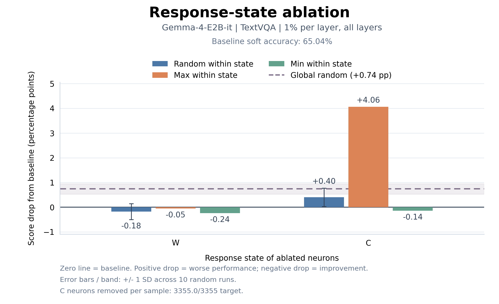

### ChartQA

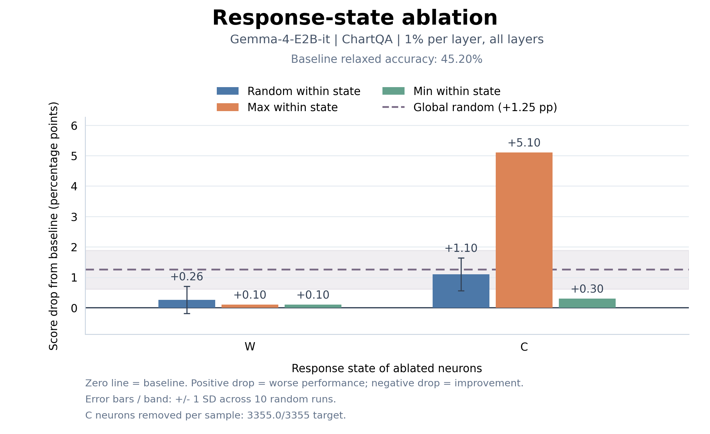
