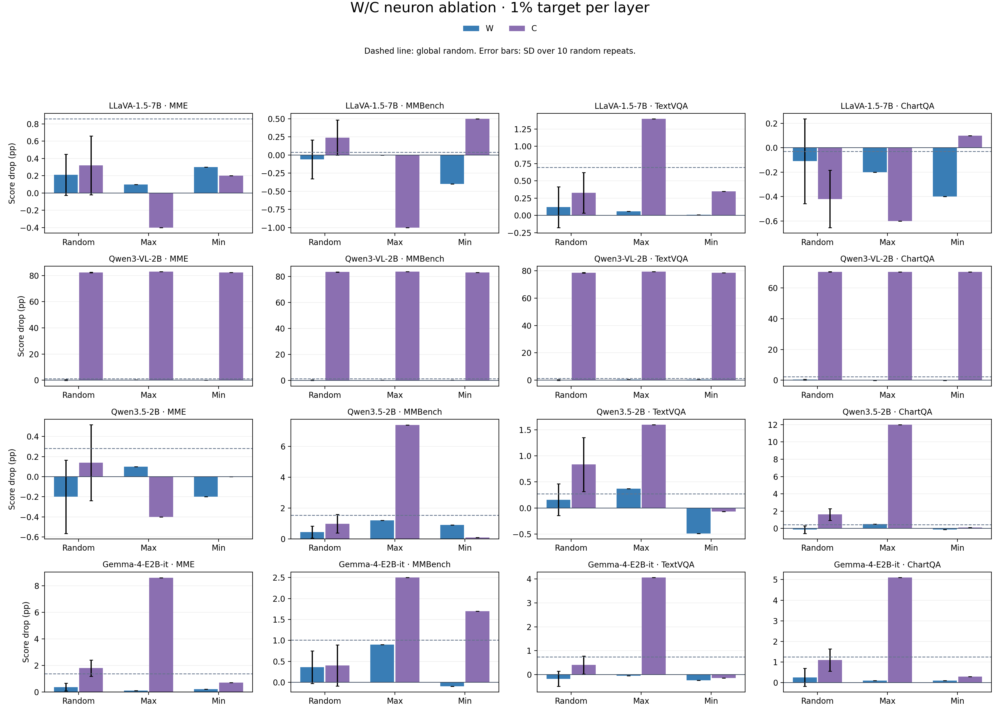

# W/C 1% neuron ablation: 16 completed runs

Each model–dataset run contains 1,000 frozen examples and 35 generation conditions (35,000 predictions).
Positive score drop means performance worsened relative to the same run's baseline. Random values show mean ± SD across 10 complete repeats; Max and Min use one deterministic run.
The target is 1% per decoder layer. A state pool smaller than the target is deleted in full, without drawing from another class.

| Model | Dataset | Baseline | W random drop | C random drop | W Max drop | C Max drop | W Min drop | C Min drop | Global random drop | C actual/target |
|---|---|---:|---:|---:|---:|---:|---:|---:|---:|
| LLaVA-1.5-7B | MME | 79.30% | +0.21 ± 0.24 | +0.32 ± 0.34 | +0.10 | -0.40 | +0.30 | +0.20 | +0.86 ± 0.51 | 3425.6/3520 |
| LLaVA-1.5-7B | MMBench | 73.30% | -0.06 ± 0.27 | +0.24 ± 0.24 | +0.00 | -1.00 | -0.40 | +0.50 | +0.04 ± 0.45 | 3426.8/3520 |
| LLaVA-1.5-7B | TextVQA | 48.64% | +0.12 ± 0.30 | +0.33 ± 0.29 | +0.06 | +1.40 | +0.01 | +0.35 | +0.69 ± 0.44 | 3424.3/3520 |
| LLaVA-1.5-7B | ChartQA | 18.60% | -0.11 ± 0.35 | -0.42 ± 0.23 | -0.20 | -0.60 | -0.40 | +0.10 | -0.03 ± 0.38 | 3424.9/3520 |
| Qwen3-VL-2B | MME | 83.10% | +0.11 ± 0.34 | +82.30 ± 0.20 | +0.40 | +82.90 | +0.00 | +82.40 | +1.09 ± 0.60 | 1656.7/1708 |
| Qwen3-VL-2B | MMBench | 83.80% | +0.13 ± 0.25 | +83.44 ± 0.14 | +0.20 | +83.70 | +0.30 | +83.20 | +1.31 ± 0.71 | 1654.2/1708 |
| Qwen3-VL-2B | TextVQA | 79.70% | +0.03 ± 0.34 | +78.59 ± 0.21 | +0.32 | +79.35 | +0.36 | +78.50 | +1.31 ± 0.51 | 1656.2/1708 |
| Qwen3-VL-2B | ChartQA | 72.10% | +0.41 ± 0.27 | +70.56 ± 0.05 | -0.20 | +70.50 | -0.10 | +70.50 | +2.23 ± 0.42 | 1655.5/1708 |
| Qwen3.5-2B | MME | 83.90% | -0.20 ± 0.37 | +0.14 ± 0.38 | +0.10 | -0.40 | -0.20 | +0.00 | +0.28 ± 1.10 | 1464.0/1464 |
| Qwen3.5-2B | MMBench | 83.90% | +0.44 ± 0.39 | +0.99 ± 0.61 | +1.20 | +7.40 | +0.90 | +0.10 | +1.54 ± 0.54 | 1464.0/1464 |
| Qwen3.5-2B | TextVQA | 77.48% | +0.16 ± 0.30 | +0.83 ± 0.52 | +0.37 | +1.60 | -0.49 | -0.07 | +0.27 ± 0.88 | 1464.0/1464 |
| Qwen3.5-2B | ChartQA | 69.20% | -0.13 ± 0.45 | +1.63 ± 0.68 | +0.50 | +12.00 | -0.10 | +0.10 | +0.43 ± 0.75 | 1464.0/1464 |
| Gemma-4-E2B-it | MME | 70.30% | +0.36 ± 0.29 | +1.79 ± 0.61 | +0.10 | +8.60 | +0.20 | +0.70 | +1.37 ± 0.56 | 3355.0/3355 |
| Gemma-4-E2B-it | MMBench | 73.00% | +0.36 ± 0.39 | +0.40 ± 0.49 | +0.90 | +2.50 | -0.10 | +1.70 | +1.01 ± 0.99 | 3355.0/3355 |
| Gemma-4-E2B-it | TextVQA | 65.04% | -0.18 ± 0.32 | +0.40 ± 0.37 | -0.05 | +4.06 | -0.24 | -0.14 | +0.74 ± 0.21 | 3355.0/3355 |
| Gemma-4-E2B-it | ChartQA | 45.20% | +0.26 ± 0.44 | +1.10 ± 0.54 | +0.10 | +5.10 | +0.10 | +0.30 | +1.25 ± 0.63 | 3355.0/3355 |

## Interpretation limits

- Qwen3-VL and LLaVA have one C-pool shortfall layer in every sample. Their C intervention deletes fewer neurons than W or global random, so those contrasts also differ in total deletion dose.
- C is defined from non-visual, non-question-text, non-padding input positions, including native template and special tokens. These interventions do not isolate a particular token or prove which position caused a score change.
- The Qwen3-VL C conditions often produce empty output or repeat template text; the score collapse therefore reflects generation failure as well as answer correctness.
- Random SD describes variation across the ten selection runs. It is not a confidence interval over newly sampled questions.

Complete condition statistics: [CSV](wc_ablation_conditions.csv). W/C contrasts: [CSV](wc_ablation_comparisons.csv).
